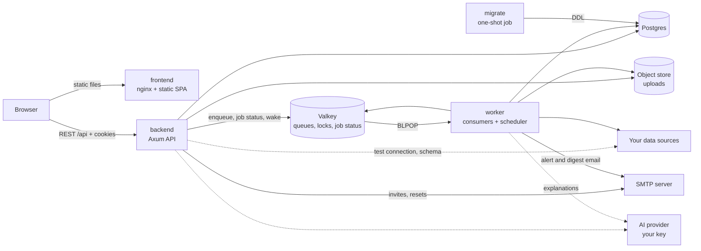
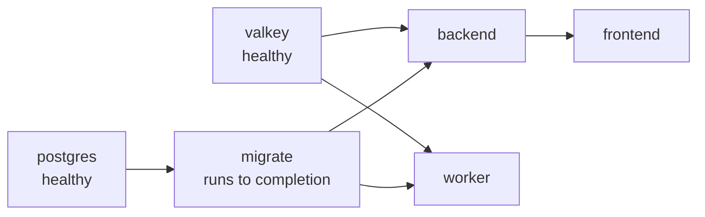
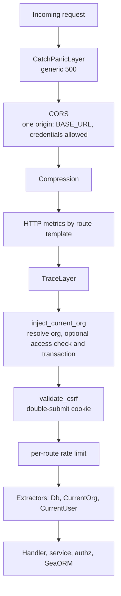
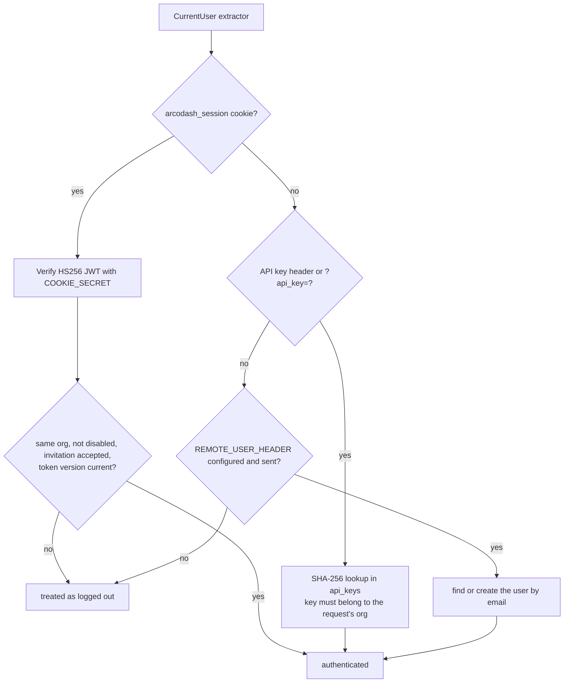
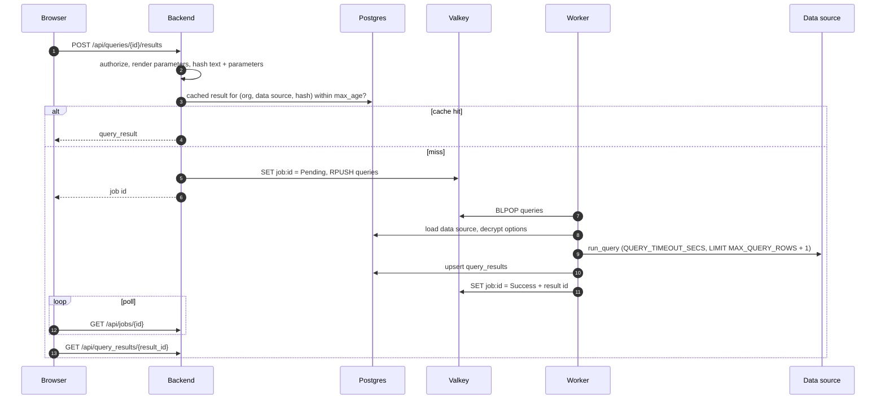
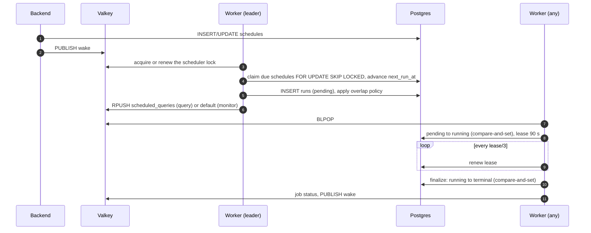
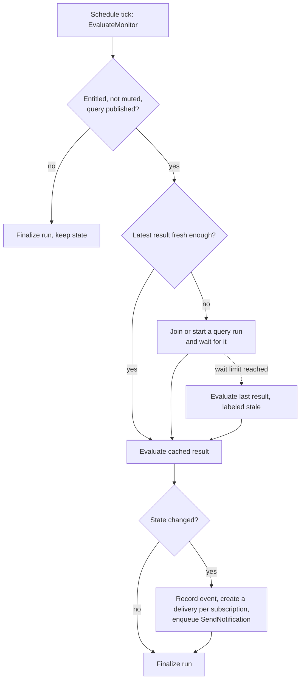
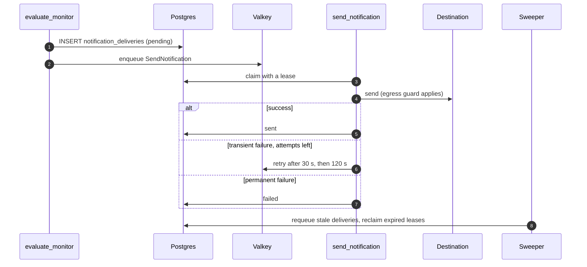
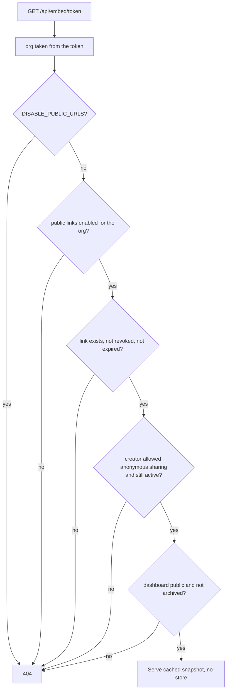

# arcodash architecture

How arcodash is put together: what runs where and how requests and background jobs flow.
Environment variables are in [ENV_VARS.md](ENV_VARS.md);
installation is in the [README](README.md) and [docs/self-hosting.md](docs/self-hosting.md).

1. [Overview](#1-overview)
2. [Components](#2-components)
3. [Code layout](#3-code-layout)
4. [How it works](#4-how-it-works): [requests and auth](#41-requests-authentication-and-permissions), [query execution](#42-query-execution), [scheduling](#43-scheduling), [monitors and alerts](#44-monitors-and-alerts), [dashboards and public links](#45-dashboards-and-public-links), [data sources](#46-data-sources), [AI](#47-ai), [users and migrations](#48-users-and-migrations)
5. [Security model](#5-security-model)

## 1. Overview

arcodash runs as three long-running processes and a one-shot job:

- **frontend**: the React/Vite single-page app, served as static files by nginx.
- **backend**: the Axum REST API under `/api`. It handles requests, authentication and
  authorization, and enqueues work. It never runs user queries against data sources.
- **worker**: consumes job queues, runs queries against your data sources, evaluates monitors,
  delivers notifications and runs the scheduler.
- **migrate**: applies database migrations and exits.

State lives in **Postgres** (everything durable), **Valkey** (job queues, short-lived job status,
locks, pub/sub; Redis protocol) and an **object store** (uploaded CSV and SQLite files only).



- The browser calls the backend directly at the URL built into the SPA; nginx serves files only.
- The backend and worker never call each other. They communicate through Postgres rows and Valkey
  keys only.
- Losing Valkey loses queued messages and job status, not data: scheduled runs, monitor checks
  and notification deliveries are recovered from their Postgres rows.

## 2. Components

`docker-compose.yml` (local) and `docker-compose.prod.yml` (self-host) define the same services.
Images come from `docker/rust.Dockerfile` (targets `backend`, `worker`, `migrate`) and
`docker/frontend.Dockerfile`.



| Component | Responsibilities | Scaling and health |
|---|---|---|
| frontend | Serves the SPA (`docker/nginx.conf`: client-side routing, immutable `/assets/`). `VITE_API_BASE_URL` is fixed at build time | Stateless. `GET /` |
| backend | Sessions and SSO, users and groups, data sources, queries, dashboards, monitors, destinations, schedules, AI endpoints, public links, audit log | Stateless (signed JWT cookies); run N replicas and set `RATE_LIMIT_REPLICAS`, since per-route rate limiters live in process memory. `GET /health`, `GET /api/health`; `GET /metrics` only with `METRICS_TOKEN` |
| worker | Queue consumers, the scheduler and sweepers, escalations and digests, upload cleanup, a daily schema pass, a heartbeat | Run N replicas (`--scale worker=N`). Scheduler, sweepers and cron jobs are leader-elected through Valkey locks. `/health` and unauthenticated `/metrics` on its own port: keep it private |
| migrate | Applies pending migrations, then exits | Runs on every `up`; backend and worker wait for it |

**Worker queues.** Jobs travel on Valkey lists `arcodash:queue:<name>`: `queries` (interactive
runs), `default` (monitor checks, notifications, digests, mail) and `schemas` (schema and AI
profile refresh) share the fast tier (`FAST_CONCURRENCY`, default 64); `scheduled_queries`
(scheduled and manual runs, possibly hours long) has its own long tier (`LONG_CONCURRENCY`,
default 8), so long runs never starve interactive ones. `WORKER_QUEUES` limits which queues a
worker consumes, for example to give long scheduled queries their own deployment. Each running job
holds a database connection, so raise `DB_MAX_CONNECTIONS` with the concurrency.

**Worker identity.** Each replica needs a unique id for leases and heartbeats: `WORKER_ID`, else
`HOSTNAME` (Docker sets a unique one per container), else a random suffix. Never set the same value
on two replicas.

**Object store.** Only uploaded CSV and SQLite files live there (`crates/shared/src/storage.rs`);
query results are stored in Postgres. The client speaks the Google Cloud Storage JSON API. The
compose files run a bundled store and set `STORAGE_EMULATOR_HOST`; without it the client calls
Google Cloud Storage with credentials from the GCP metadata server.

**Mail.** Backend (invitations, password resets) and worker (alerts, digests) share one SMTP
mailer (`crates/shared/src/mailer.rs`). Without `SMTP_HOST`, mail is skipped and recorded as such,
and invitation links are logged. The local compose adds Mailpit to catch mail.

## 3. Code layout

| Path | Contents |
|---|---|
| `apps/backend` | `arcodash-backend`. `src/lib.rs` (`build_app`), `src/api/router.rs` (every route), `src/api/handlers` (HTTP), `src/services` (business logic), `src/auth`, `src/authz`, `src/middleware`. Extra binary `rotate_encryption_key` |
| `apps/worker` | `arcodash-worker`, also a library (`arcodash_worker::run`). `src/consumer` (queue loops), `src/handlers` (jobs), `src/scheduler` (deadline loop, sweepers, escalations), `src/run_lifecycle.rs` |
| `apps/frontend` | React, Vite, TanStack Query, CodeMirror, Recharts. `src/lib/api.ts` (API client), `src/lib/jobs.ts` (job polling) |
| `crates/shared` | `arcodash-core`: entities, config, connectors, queue, secrets, egress guard, storage, AI, authorization, mailer, monitor evaluation |
| `crates/conveyor` | `arcodash-conveyor`: a durable task engine (tasks in Postgres, Valkey transport, leases, schedules). See its [README](crates/conveyor/README.md) |
| `crates/migration` | `arcodash-migration`: a baseline SQL file plus incremental migrations |
| `tests/e2e` | Playwright specs |

## 4. How it works

### 4.1 Requests, authentication and permissions

`build_app` mounts `/health`, `/ping` and `/metrics` at the root and everything else under `/api`.
A request passes these layers from the outside in:



**Organization.** An install has exactly one organization, `default`, created by the baseline
migration. It holds the instance-wide settings (name, AI, public links) edited on
the **Organization** and **AI Settings** pages. Public links take the organization from their token, never from the
visitor's session.

**Authentication** is resolved per route, in this order:



- The session cookie is HttpOnly, `SameSite=Lax`, valid 14 days and `Secure` except on localhost.
  It is host-only, so serve the SPA and the API from the same hostname. Changing or resetting a
  password bumps a token version that invalidates every older cookie.
- Password login is on by default, plus SAML, LDAP and the trusted header when configured.
  Passwords are hashed with Argon2id.
- **CSRF:** cookie-authenticated writes must echo the `csrf_token` cookie in `X-CSRF-Token`.
  Pre-session endpoints (login, SAML ACS, invitation accept, password reset) are exempt, and API
  key requests are exempt only when no session cookie is present.

**Authorization** combines two checks (`apps/backend/src/authz/authorize.rs`):

```text
allow = is_admin
     OR ( has_capability(user, permission)              // roles on the user's groups
          AND object_reach(user, object) >= required )  // owner, grant or visibility
```

- *Capabilities* come from roles (Admin, Editor, Viewer and custom roles) attached to groups. The
  builtin groups are `admin`, `default` (Editor) and `viewers` (Viewer).
- *Reach* comes from ownership, explicit user or group grants, and the object's visibility.
  Published workspace objects are visible to the organization; drafts are not.
- *Data source scope:* each group is unrestricted or limited to an allowlist of data sources, and
  capability and reach must come from the same group. Unknown values fail closed.

**Rate limits** apply per IP on anonymous endpoints and per user elsewhere. Behind a reverse
proxy set `TRUSTED_PROXY_HOPS`, or every client shares the proxy's address and budget.

### 4.2 Query execution

Running a saved query (`POST /api/queries/{id}/results`) or ad-hoc SQL (`POST /api/query_results`)
is asynchronous:



- **Cache.** Results are cached per query text and parameter values (`max_age` defaults to 24 h;
  `max_age=0` forces a run). Results are stored as JSONB in Postgres, one row per distinct query
  and parameter combination.
- **Parameters** (`{{ name }}`) are substituted into the SQL text, not bound. Number, date and
  dropdown values are validated; free-text values are inserted as written, so using them requires
  manage access to the data source.
- **Row cap.** Where the connector supports it, an unbounded `SELECT` gets
  `LIMIT MAX_QUERY_ROWS + 1` and the result is marked `truncated`.
- **Cancel** (`DELETE /api/jobs/{id}`) stops the worker waiting and discards the result. It does
  not stop the statement in the database, which runs until it finishes or hits its own timeout.
- **Durability.** An interactive job lives only in Valkey; if its worker dies, it is not retried
  and the UI stops polling after about 5 minutes. Scheduled and manual runs are durable (4.3).
- **Concurrency.** `max_concurrent_runs` per data source (default 4) caps scheduled and manual runs;
  runs over the cap wait until a slot frees.

### 4.3 Scheduling

Scheduled queries and monitor checks share one engine in the worker, driven by two tables:
`schedules` (what and when: an interval, a cron expression or a time of day, in the schedule's
timezone) and `runs` (one row per attempt, the source of truth for execution state). A schedule
runs the **published** version of a query, never the draft.



- **Deadline loop.** The leader sleeps until the next due schedule, a pub/sub wake or at most
  120 s. When a previous run is still in flight, `overlap_policy` either records a `skipped` run
  or coalesces the tick into one follow-up run.
- **One exit.** Every run ends in a single conditional update, so a worker racing the sweeper is
  harmless. Failures back off exponentially (up to 1 h) and a schedule auto-pauses after
  `AUTO_PAUSE_THRESHOLD` (default 10) consecutive failures.
- **Sweeper.** Every 60 s it fails runs whose lease expired, times out runs nobody claimed,
  re-enqueues stale pending runs and notification deliveries, and resumes monitor checks whose
  wake-up was lost.
- **At-least-once.** If a worker dies after the query ran but before the run was finalized, the
  query runs again. Scheduled SQL is expected to be read-only. The leader lock only avoids
  duplicate work; correctness comes from the compare-and-set updates and unique indexes.

Some job types can also run on `arcodash-conveyor`, a durable task engine with per-task rows,
leases, tiers and per-resource caps. It is opt-in per job type through the `CONVEYOR_*_ENABLED`
flags (all off by default), which must match on backend and worker.

### 4.4 Monitors and alerts

A monitor is a query plus a condition, with users subscribed through destinations.

- **Threshold** monitors compare one column of the first result row with a number.
  **Baseline** monitors flag values far from the median of the last 30 observations (a robust
  z-score; at least 7 observations first). Freshness, null-rate and row-count checks are queries
  that return one such number.
- States are `unknown`, `ok`, `triggered` and `unevaluable` (for example no rows). Muted monitors
  are not evaluated.



"Fresh enough" means younger than the monitor's `max_data_staleness_secs`, else its schedule
interval, else `MONITOR_DEFAULT_STALENESS_SECS`. A waiting check holds no worker slot; the query
run wakes it when it finishes.

**Notifications** are durable rows written before the job is enqueued, so a crash cannot lose one:



- **Destinations:** email, Slack, Mattermost, Microsoft Teams, Google Chat, Discord, webhook,
  PagerDuty and Datadog. Their options are encrypted with `ENCRYPTION_KEY`.
- **Escalation steps** notify further destinations after a delay until someone acknowledges,
  mutes, or the monitor returns to `ok`.
- **Digests** go out once a day at each user's chosen local hour, summarizing the last 24 h of
  their monitors.
- A state change inside the monitor's re-arm window, or a first check that is already healthy,
  does not notify.

### 4.5 Dashboards and public links

- Dashboards hold widgets (visualizations of queries, or text). Dashboards and queries both have a
  draft and a published version; viewers see the published one.
- Rendering is client-driven: each tile calls the normal execute endpoint with caching and polls
  like 4.2. Dashboard parameters are passed to every tile.
- **Public links and embeds** are random bearer tokens. They serve only the cached published
  snapshot and never run a query:



Every failure is the same 404. Responses are `no-store`, `noindex` and `no-referrer`, embeds can
be framed by any origin unless the link was created with an allowlist, and requests are rate
limited per IP. Anonymous links
need the `share_public_anonymous` permission (admins have it; the Editor role does not).

### 4.6 Data sources

- **Connectors** implement the `QueryRunner` trait (`crates/shared/src/connectors/mod.rs`): a
  configuration schema (which generates the UI form), connection test, schema listing, query
  execution and the hosts it will contact. `ConnectorRegistry::with_db` registers all 20; backend
  and worker build the same registry. See the [connector reference](docs/reference/connectors.md).
- **Credentials** are encrypted with AES-256-GCM using `ENCRYPTION_KEY`, decrypted only in the
  backend (test, schema) and worker (runs), and never returned by the API. Rotate the key with the
  `rotate_encryption_key` binary (see [ENV_VARS.md](ENV_VARS.md#security-notes)).
- **Egress guard** (`crates/shared/src/net_guard.rs`): connectors and webhooks refuse loopback,
  private, link-local and metadata addresses. HTTP clients are pinned to the addresses that were
  checked; native database drivers resolve the hostname again, which leaves a small DNS-rebinding
  gap. `ARCODASH_ALLOW_PRIVATE_CONNECTORS=1` disables the guard for local use.
- **Schema** is cached on the data source and refreshed on demand or by a daily pass, through a
  deduplicated job on the `schemas` queue.
- **Uploads:** CSV and SQLite files are validated, stored in the object store under the
  organization's prefix and linked to a data source. SQLite files are opened read-only. Uploads
  never linked to a data source are deleted after 24 h.

### 4.7 AI

AI is optional and uses your key: the organization's key (AI Settings) if set, else
`ANTHROPIC_API_KEY`, `OPENAI_API_KEY` or `GEMINI_API_KEY`. Nothing is sent to a provider until a
key exists. Providers sit behind one `AiProvider` trait (`crates/shared/src/ai`).

| Feature | Runs in | What is sent |
|---|---|---|
| Ask with AI, generate SQL | backend | Schema, sample values (if enabled), the question. Draft SQL must be read-only, is previewed through the normal execute path and repaired from the error text only |
| Visualization suggestion | backend | Column names, types and row count |
| Monitor suggestions, monitors and tiles from text | backend | Schema and profile; generated SQL is checked read-only |
| Explain dashboard | backend | Bounded summaries of cached widget results |
| Schema profile, column descriptions | worker | Table and column names, sampled values |
| Alert explanation | worker | Results of up to 3 read-only aggregate queries; 20 s budget |

Organization settings control the monthly budget, alert explanations, dashboard summaries and
whether sample values are sent. Prompts and sampled rows are not
logged. See [AI features](docs/guide/ai.md).

### 4.8 Users and migrations

- **First admin:** on startup the backend creates `ADMIN_EMAIL` / `ADMIN_PASSWORD` in the `admin`
  group if that user does not exist. There is no self-signup route.
- **Invitations** email a single-use link valid 7 days; **password resets** a link valid 1 hour
  (always answered with success, so accounts cannot be enumerated).
- **SSO** (SAML, LDAP, trusted header) creates users on first login in the `viewers`
  group, or in groups named by the identity provider. IdP-asserted admin groups are ignored.
- **Audit log:** significant actions are recorded and readable by admins (`GET /api/events`).
- **Migrations** (`crates/migration`) start from one baseline and are tracked in
  `seaql_migrations`. A guard refuses to run the migrator against a database that was migrated by
  a different migration history (see `ARCODASH_SCHEMA_TRACK` in ENV_VARS.md). Back up before
  upgrading; compose runs `migrate` to completion before the new backend and worker start.

## 5. Security model

| Area | How it works | What you should do |
|---|---|---|
| Secrets at rest | Data source credentials, destination options, organization AI keys and embed secrets are AES-256-GCM encrypted. Passwords use Argon2id; API keys are stored as SHA-256 digests | Generate `ENCRYPTION_KEY` and `COOKIE_SECRET` with `openssl rand -hex 32` and back them up apart from the database |
| Sessions | Signed HttpOnly cookie, 14 days, server-side invalidation, CSRF token on writes | Terminate TLS in front of the stack |
| Authorization | Server-side capability plus object reach plus data source scope; unknown values fail closed | Use `viewers` for read-only users; grant anonymous sharing deliberately |
| Queries | arcodash runs the SQL users write with the data source's credentials. Only AI-generated SQL is checked read-only. Scheduled runs are at-least-once | Give each data source a read-only database role |
| Egress | Connectors, webhooks and custom AI endpoints refuse private and metadata addresses | Keep `ARCODASH_ALLOW_PRIVATE_CONNECTORS` off on servers reachable from untrusted networks |
| Public links | Bearer tokens, uniform 404s, cached data only, per-IP limits | `DISABLE_PUBLIC_URLS=true` turns them off |
| Internal services | Job messages in Valkey are trusted; the worker re-checks organization ownership | Keep Postgres, Valkey and the worker port private |
| Trusted header auth | `REMOTE_USER_HEADER` accepts the email in a header as identity | Enable only behind a proxy that strips the header from clients |

Report vulnerabilities through [SECURITY.md](SECURITY.md).
