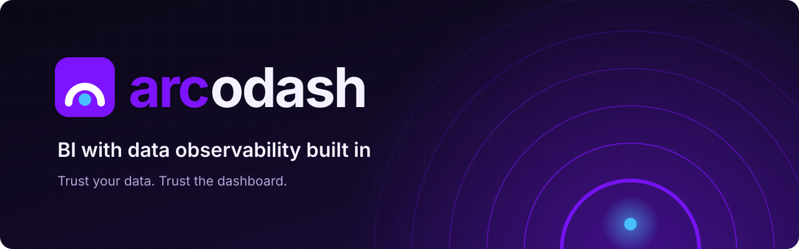
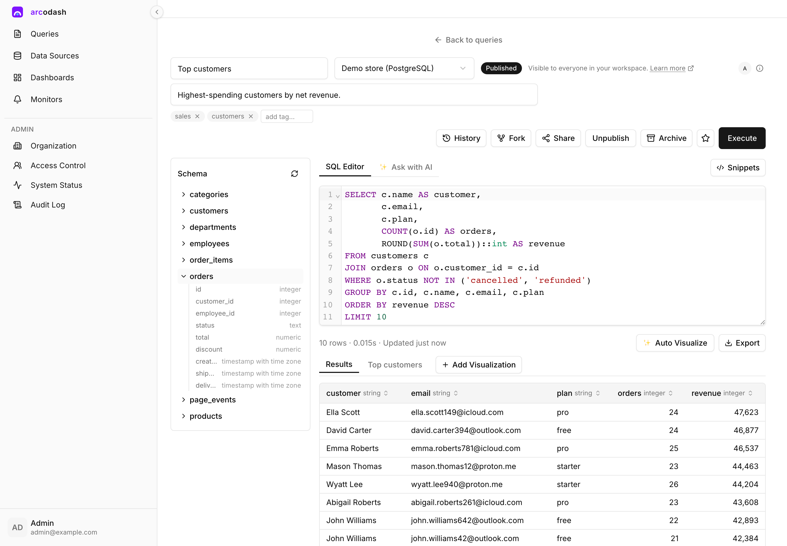
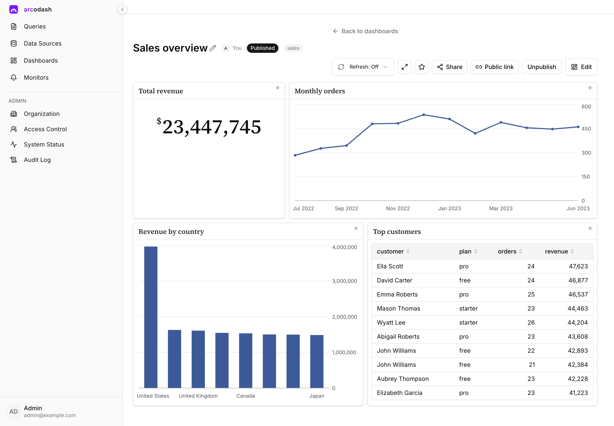
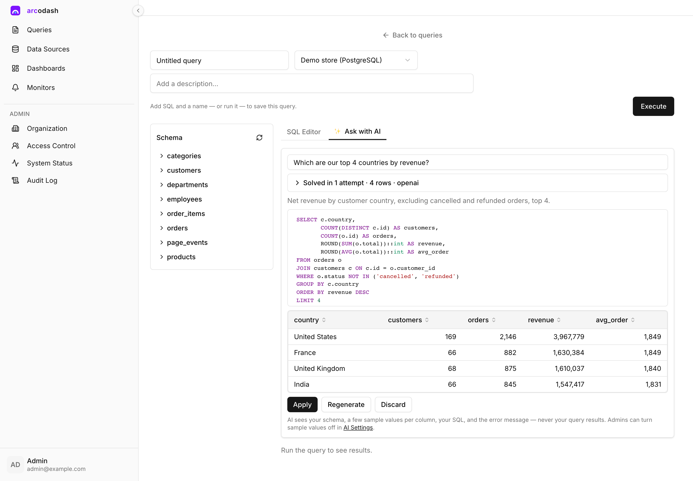
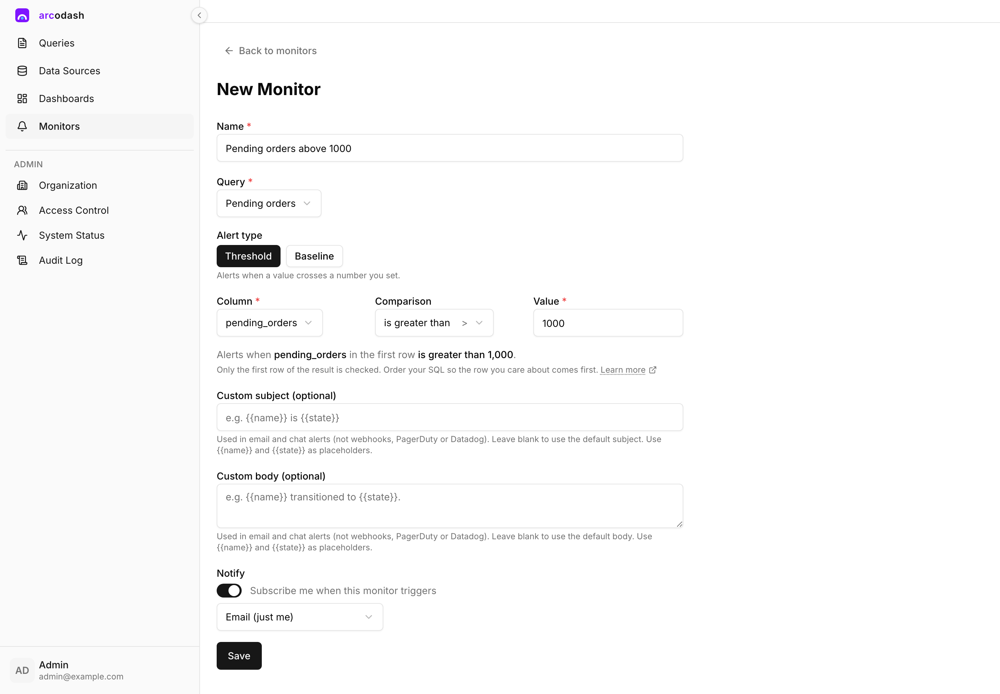
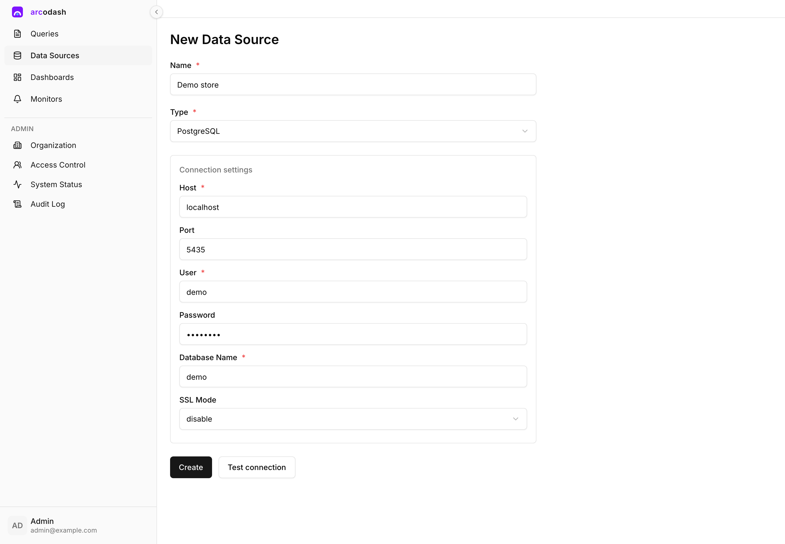
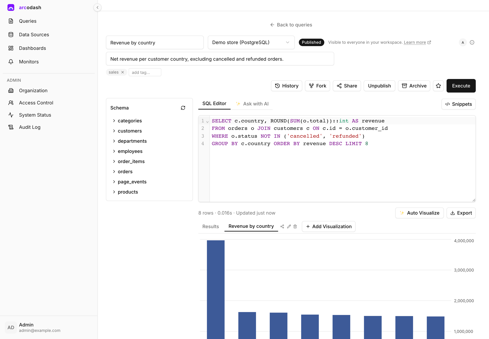
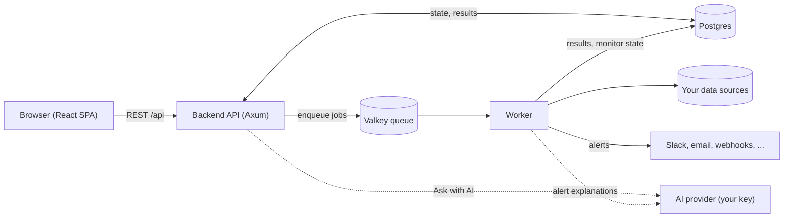

<div align="center">

<p align="center">
  <a href="https://www.arcodash.com">
    
  </a>
</p>

<p align="center">
  <strong>AI sprinkled Open-source BI with data observability built in.</strong><br>
  Dashboards that tell you when they're wrong.
</p>

<p align="center">
  <a href="LICENSE.md"></a>
  <a href="https://github.com/arcodash/arcodash/actions/workflows/ci.yml"></a>
  <a href="https://github.com/arcodash/arcodash/releases"></a>
  <a href="CONTRIBUTING.md"></a>
  
  
</p>

<p align="center">
  <a href="https://www.arcodash.com"><strong>Website</strong></a> ·
  <a href="https://www.arcodash.com/docs"><strong>Docs</strong></a> ·
  <a href="https://www.arcodash.com"><strong>arcodash Cloud</strong></a> ·
  <a href="https://cloud.arcodash.com/public/embed/68bd7b205ca5498ca687dde74d6fdef0c291731d9d8a46fdaf43abfe55120e9d"><strong>Live demo</strong></a> ·
  <a href="https://github.com/arcodash/arcodash/issues/new?template=bug_report.yml"><strong>Report a bug</strong></a> ·
  <a href="https://github.com/arcodash/arcodash/issues/new?template=feature_request.yml"><strong>Request a feature</strong></a>
</p>

</div>

## What is arcodash?

arcodash is open-source BI with data observability built in. Connect a database or an API, write SQL or ask a question in plain English, and build dashboards from the results. Monitors watch the data underneath those dashboards (freshness, null rate, row count, thresholds and learned baselines), and when one fails, AI explains why and sends the explanation to Slack or wherever your team already looks.

The backend and worker are Rust (Axum), the web app is React and Vite, Postgres holds all state and Valkey runs the job queue. It is licensed under AGPL-3.0 and runs with one `docker compose up`.

> **Count on your data. Count on the dashboard.**

## ✨ Features

- **Connect** 20 sources: PostgreSQL, MySQL, MariaDB, TiDB, SQL Server, SQLite, Redshift, CockroachDB, ClickHouse, Databricks, Elasticsearch, MongoDB, Prometheus, InfluxDB, BigQuery, Snowflake, Amazon Athena, JSON over HTTP, CSV upload, and Query Results for querying across your other queries. Credentials are encrypted at rest and an egress guard blocks private and metadata addresses by default.
- **Query** in a SQL editor with a schema browser, snippets, parameters, scheduled refresh, version history and draft/publish, or ask in plain English and let AI draft, preview and repair the SQL. Export to CSV, TSV or XLSX.
- **Visualize** with tables, line, bar, area, pie and scatter charts, counters and funnels.
- **Dashboards** with a grid layout, dashboard parameters, auto-refresh, "Add with AI" tiles and an AI "Explain" summary of what changed.
- **Monitors** for freshness, null rate, row count and thresholds, plus baseline monitors that learn what normal looks like.
- **Alerts** to email, Slack, webhooks, PagerDuty, Mattermost, Microsoft Teams, Discord, Google Chat and Datadog, each with a stats line and an optional AI explanation.
- **AI with your own key**: Anthropic, OpenAI or Gemini, set instance-wide or per organization, with a monthly budget cap and a usage page.
- **Share and embed** with per-object permissions, secret-token public links and iframe embeds.
- **Auth** with passwords, SAML 2.0, LDAP / Active Directory, or a trusted proxy header.
- **Admin**: users, groups with per-group data source access, system status and an audit log. Everything is also available over a [REST API](docs/reference/api-reference.md).

<br>

<table>
  <tr>
    <td width="50%" align="center">
      <br>
      <sub><b>SQL editor</b>: schema browser, results and one-click visualizations</sub>
    </td>
    <td width="50%" align="center">
      <br>
      <sub><b>Dashboards</b>: share, embed and refresh on a schedule</sub>
    </td>
  </tr>
  <tr>
    <td width="50%" align="center">
      <br>
      <sub><b>Ask with AI</b>: describe the question, get SQL</sub>
    </td>
    <td width="50%" align="center">
      <br>
      <sub><b>Monitors</b>: watch the data underneath your dashboards</sub>
    </td>
  </tr>
  <tr>
    <td width="50%" align="center">
      <br>
      <sub><b>Connect</b>: forms generated from each connector's schema</sub>
    </td>
    <td width="50%" align="center">
      <br>
      <sub><b>Visualize</b>: add a chart to any query result</sub>
    </td>
  </tr>
</table>

## 🚀 Quick start

You need Docker with the Compose plugin.

```bash
git clone https://github.com/arcodash/arcodash.git && cd arcodash
cp .env.example .env
docker compose up --build
```

Open **http://localhost:3000** and sign in as `admin@example.com` / `change-me-now` (set in `.env`; change them before the first start if you like). The first build compiles the Rust services and takes a while; later starts are fast.

Want something to query? Start the sample database and add it under **Data Sources → New data source → PostgreSQL** with host `demo-db`, port `5432`, user `demo`, password `demo1234`, database `demo`:

```bash
docker compose --profile demo up -d demo-db
```

Then write a query, add a visualization, publish the query (dashboards only show published queries), pin it to a dashboard and put a monitor on it. Outgoing mail lands in Mailpit at http://localhost:8025.

`.env.example` is for local use only. To run arcodash on a server, see [Self-hosting](docs/self-hosting.md).

## 🛠️ Run from source

For working on the code: the backend, worker and frontend run as native processes with hot reload, against Postgres, Valkey, the object store and Mailpit in Docker.

| Tool | Version |
|---|---|
| Rust | 1.99.1, installed from `rust-toolchain.toml` by `rustup` |
| Node.js | 24 |
| pnpm | 11.9.0 (pinned in `package.json`; `corepack enable pnpm` installs it) |
| Docker | for the infrastructure containers |
| xmlsec1, libxml2, pkg-config, clang | for SAML: `brew install libxmlsec1 pkgconf` on macOS, `apt install libxmlsec1-dev libxml2-dev pkg-config libclang-dev` on Debian/Ubuntu |
| cargo-watch | optional, for backend hot reload |

```bash
cp .env.example .env
pnpm install
scripts/dev.sh up          # infra, migrations, backend :8080, worker, frontend :3000 in the background
scripts/dev.sh logs worker # follow a log
scripts/dev.sh down        # stop backend, worker and frontend; scripts/infra.sh stop stops the containers (data is kept)
```

Or run each piece in its own terminal: `scripts/infra.sh`, `scripts/migrate.sh`, `scripts/backend.sh`, `scripts/worker.sh` and `scripts/frontend.sh`. The native processes and the Docker app services use the same ports, so run one or the other. For the sample database natively, use `localhost:5435` instead of `demo-db:5432`. See [scripts/README.md](scripts/README.md).

## ⚙️ Configuration

Everything is configured with environment variables, all listed in [ENV_VARS.md](ENV_VARS.md). The ones to set first are `DATABASE_URL`, `VALKEY_URL`, `COOKIE_SECRET`, `ENCRYPTION_KEY`, `BASE_URL`, `UPLOAD_BUCKET` and `ADMIN_EMAIL` / `ADMIN_PASSWORD`.

To turn on AI, set `ANTHROPIC_API_KEY`, `OPENAI_API_KEY` or `GEMINI_API_KEY`, or let an admin add a key in **AI Settings** (`/organization/ai`; the **Ask with AI** tab links there until a key is set). Prompts include schema, a few sample values per column, your SQL and error messages, never your full query results. See [AI features](docs/guide/ai.md).

## 🔌 Connectors

| Category | Connectors |
|---|---|
| Relational | PostgreSQL, MySQL, MariaDB, TiDB, SQL Server, CockroachDB, Amazon Redshift |
| Warehouses | ClickHouse, BigQuery, Snowflake, Databricks, Amazon Athena |
| Search, documents and metrics | Elasticsearch, MongoDB, Prometheus, InfluxDB (v1) |
| Files and APIs | CSV upload, SQLite upload, JSON over HTTP |
| Cross-source | Query Results |

Status, configuration fields and how to add your own are in the [connector reference](docs/reference/connectors.md).

## 🏗️ Architecture



The backend enqueues query and monitor jobs on Valkey; the worker runs them against your data sources, writes results to Postgres and sends alerts. [ARCHITECTURE.md](ARCHITECTURE.md) walks through each component and the code layout.

## 🧪 Testing

```bash
scripts/test.sh --unit-only          # Rust unit tests and Vitest, no Docker
scripts/test.sh                      # everything, against the Docker test stack
scripts/test-connectors.sh [name]    # connector tests against real databases and emulators
```

Lint with `cargo fmt --all`, `cargo clippy --workspace --all-targets -- -D warnings`, `pnpm lint` and `pnpm -r typecheck`. See [Testing](docs/guide/testing.md).

## 🤝 Contributing

Contributions of every size are welcome, from typo fixes to new connectors. Start with [CONTRIBUTING.md](CONTRIBUTING.md) and the [good first issues](https://github.com/arcodash/arcodash/labels/good%20first%20issue). Contributions are accepted under the [Contributor License Agreement](CLA.md), and everyone follows the [Code of Conduct](CODE_OF_CONDUCT.md).

## 💬 Community and support

- **Questions and ideas:** [GitHub Discussions](https://github.com/arcodash/arcodash/discussions)
- **Bugs and feature requests:** [GitHub Issues](https://github.com/arcodash/arcodash/issues)
- **Security:** please don't open a public issue. See [SECURITY.md](SECURITY.md) or email security@arcodash.com.

Changes are recorded in the [changelog](CHANGELOG.md). Don't want to run it yourself? [arcodash Cloud](https://www.arcodash.com) is the same product, hosted.

## 📄 License

arcodash is licensed under the [GNU Affero General Public License v3.0](LICENSE.md). You can use, modify and self-host it freely; if you offer a modified version to others as a network service, you must make your modified source available to its users.

Copyright © 2026 Refael Dakar.

<br>

<p align="center">
  <a href="https://www.arcodash.com"></a>
  <br>
  <sub>Made with care by the arcodash team · <a href="https://www.arcodash.com">arcodash.com</a></sub>
</p>
